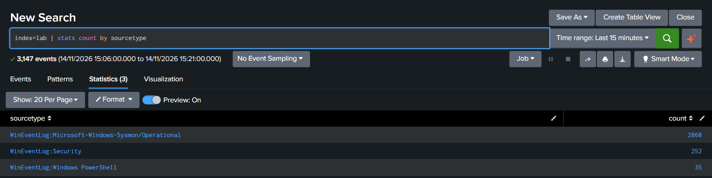
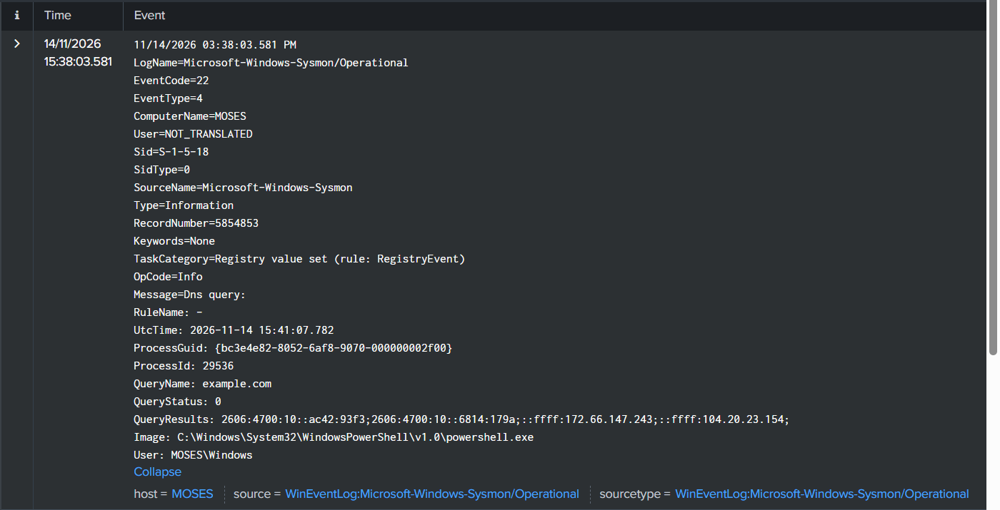

# Splunk SOC Lab: Detecting a Simulated Intrusion with Sysmon

A home SOC lab built from scratch on a Windows laptop. I generated a benign simulated intrusion, collected the telemetry with **Sysmon** and **Splunk Enterprise**, then investigated it as a Tier 1 SOC analyst would: build the timeline, correlate the evidence, map it to **MITRE ATT&CK**, find where detection failed, remediate, and verify.

**Tools:** Splunk Enterprise 10.6 · Sysmon · Windows Event Logs · PowerShell · SPL

---

## Summary of findings

> A PowerShell script was launched with administrator rights and `-ExecutionPolicy Bypass`. It ran a second script staged in the user's **Music** folder through an unusual `powershell → cmd → powershell` chain, connected out to `example.com` over HTTPS, and created a scheduled task (`LabPersistenceDemo`) that runs at every logon. **Sysmon detected every stage. The Windows Security log missed the persistence entirely** because scheduled-task auditing was disabled, a real detection gap.

---

## Lab architecture

| Component | Role |
|---|---|
| **Sysmon** | Records detailed endpoint activity: process creation, network connections, DNS queries |
| **Windows Event Logs** | `Security` (logons, privilege use, audit events) and `Windows PowerShell` |
| **Splunk Enterprise** | SIEM: collects all three logs into a dedicated `lab` index for searching |
| **`Invoke-LabTelemetry.ps1`** | Benign script that reproduces four attacker behaviours, with a `-Cleanup` switch |


*All three log sources ingesting into the `lab` index.*

---

## Attack timeline (verified from real logs)

| Time | Activity | Evidence | MITRE ATT&CK |
|---|---|---|---|
| 15:37:54 | `powershell.exe -ExecutionPolicy Bypass -File Invoke-LabTelemetry.ps1`, running at **High** integrity (admin) | Sysmon 1 | T1059.001 PowerShell |
| 15:37:57 | `powershell.exe` → `cmd.exe /c powershell.exe ... -File C:\Users\Windows\Music\lab\stage1.ps1` | Sysmon 1 | T1059.003 Windows Command Shell |
| 15:37:57 | `cmd.exe` → `powershell.exe -NoProfile -ExecutionPolicy Bypass ...\Music\lab\stage1.ps1` | Sysmon 1 | T1059.001 PowerShell |
| 15:38:02 | `powershell.exe` → `172.66.147.243:443` | Sysmon 3 | T1071.001 Web Protocols |
| 15:38:03 | `powershell.exe` DNS query for `example.com`, resolving to `172.66.147.243` | Sysmon 22 | n/a |
| 15:38:03 | `schtasks.exe /Create /TN LabPersistenceDemo /TR calc.exe /SC ONLOGON /F` | Sysmon 1 | T1053.005 Scheduled Task |

---

## Investigation

### 1. What ran? Process creation (Sysmon Event 1)

The default WinEventLog format stores Sysmon fields inside the `Message` text, so I extracted them with `rex`, then filtered out known-good noise (Splunk's own bundled `postgres.exe`, which spawned `cmd.exe` repeatedly).

```spl
index=lab EventCode=1 earliest="11/14/2026:15:37:50" latest="11/14/2026:15:38:10"
| rex field=Message "(?m)^ParentImage: (?<ParentImage>[^\r\n]+)"
| rex field=Message "(?m)^Image: (?<Image>[^\r\n]+)"
| rex field=Message "(?m)^CommandLine: (?<CommandLine>[^\r\n]+)"
| search NOT ParentImage="*postgres.exe"
| table _time, ParentImage, Image, CommandLine
| sort _time
```


**Why each row is suspicious:**
- **Location:** a script running from `Music\lab`. User media folders are not where legitimate scripts live.
- **Red-flag arguments:** `-ExecutionPolicy Bypass`, `-NoProfile`, `/SC ONLOGON`.
- **Process chain:** `powershell → cmd → powershell` has no legitimate user workflow behind it.
- **Persistence:** `/TR calc.exe` is the payload the task launches. Here it is a harmless stand-in for malware.

### 2. Did it talk to the internet? Network connection (Sysmon Event 3)

```spl
index=lab EventCode=3 earliest="11/14/2026:15:37:50" latest="11/14/2026:15:38:10"
| rex field=Message "(?m)^Image: (?<Image>[^\r\n]+)"
| rex field=Message "(?m)^DestinationIp: (?<IP>[^\r\n]+)"
| rex field=Message "(?m)^DestinationPort: (?<Port>[^\r\n]+)"
| search Image="*powershell.exe"
| table _time, Image, IP, Port
```


PowerShell, not a browser, made an outbound HTTPS connection. Port 443 does not make it benign: attackers favour it because it blends in with normal web traffic.

### 3. Where was it going? DNS query (Sysmon Event 22), and correlation

```spl
index=lab EventCode=22 earliest="11/14/2026:15:37:50" latest="11/14/2026:15:38:10"
| rex field=Message "(?m)^Image: (?<Image>[^\r\n]+)"
| rex field=Message "(?m)^QueryName: (?<Domain>[^\r\n]+)"
| rex field=Message "(?m)^QueryResults: (?<Answer>[^\r\n]+)"
| search Image="*powershell.exe"
| table _time, Image, Domain, Answer
```


The DNS answer contains `172.66.147.243`, the exact IP from the network event. More importantly, the DNS event's **ProcessGuid `{bc3e4e82-8052-...}` matches the process that launched the attack script**. That is hard proof that the same PowerShell instance ran the script and made the connection, rather than an inference from timestamps.



> `example.com` is a reserved IANA test domain, chosen so nothing harmful was contacted. In a real case the next step would be a reputation check on VirusTotal / AbuseIPDB. The *behaviour* (PowerShell beaconing out mid-attack) is the finding regardless of the destination's reputation.

### 4. Detection gap: the Security log missed the persistence

Windows logs scheduled-task creation as **Security Event 4698**. It returned **zero results**.

```spl
index=lab EventCode=4698 earliest="11/14/2026:15:37:50" latest="11/14/2026:15:38:10"
```

Rather than assume the cause, I proved it on the endpoint:

```powershell
auditpol /get /subcategory:"Other Object Access Events"   # → No Auditing
Get-ScheduledTask -TaskName "LabPersistenceDemo"           # → exists, State: Ready
```


**Impact:** an organisation relying on the Security log alone would not have seen this persistence. Only Sysmon caught it.
**Recommendation:** enable the audit subcategory so Event 4698 is recorded:
```powershell
auditpol /set /subcategory:"Other Object Access Events" /success:enable
```

---

## Remediation and verification

```powershell
.\scripts\Invoke-LabTelemetry.ps1 -Cleanup
Get-ScheduledTask -TaskName "LabPersistenceDemo"   # → ObjectNotFound = task removed
```


---

## Troubleshooting: when the SIEM showed nothing

Setup did not work first time, and the fix is worth recording. After configuring inputs, `index=lab` returned 0 events. I worked down the stack one layer at a time:

| Check | Result | Conclusion |
|---|---|---|
| `index=* \| stats count by index, sourcetype` | 0 | No Windows data in *any* index, so not a wrong-index problem |
| `index=_internal WinEventLog (log_level=ERROR OR log_level=WARN)` | 0 | Splunk wasn't failing to collect. It wasn't trying |
| `splunk btool inputs list WinEventLog --debug` | empty | No event log inputs loaded at all |
| `Get-ChildItem ...\Splunk\etc\system\local\` | no `inputs.conf` | **Root cause:** the config file was never saved where Splunk reads it |

**Fix:** wrote `inputs.conf` directly from PowerShell (`Set-Content`) with three stanzas pointing at `index = lab`, restarted Splunk, and confirmed all three sourcetypes were ingesting.

**Lesson:** verify each layer (file exists → config loaded → data arriving) instead of guessing.

---

## Skills demonstrated

- SIEM deployment and log onboarding (Splunk `inputs.conf`, indexes, `btool`)
- Endpoint telemetry with Sysmon (Events 1, 3, 22)
- SPL: field extraction with `rex`, filtering, `stats`, `table`
- Process-tree analysis and noise reduction
- Event correlation using ProcessGuid
- MITRE ATT&CK mapping
- Detection-gap analysis with root cause proven on the endpoint
- Remediation and verification

---

*Built by Moses Adegun · CompTIA Security+*
