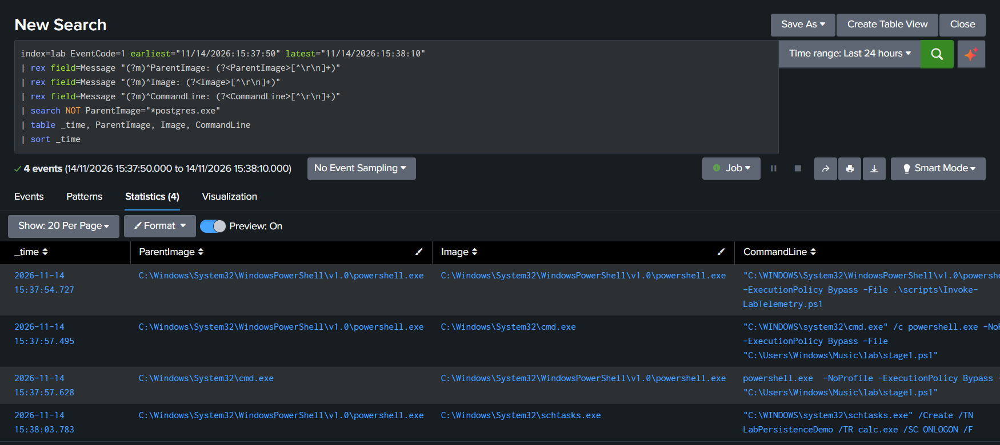
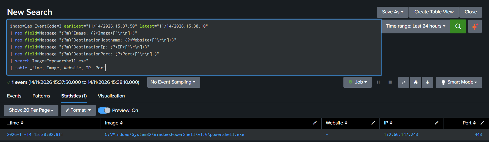
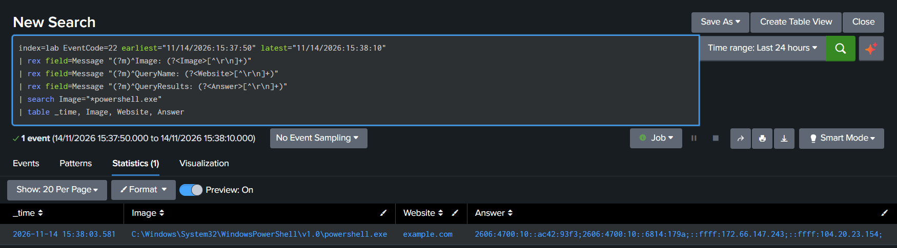
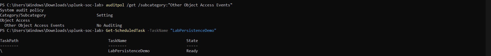
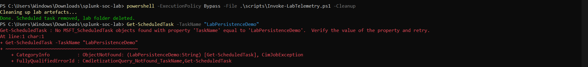

# Splunk Home Lab: Catching a Simulated Attack

I wanted to find out if I could spot an attack on my own laptop using the same kind of tools a SOC uses. So I installed Sysmon and Splunk on my Windows laptop, ran a harmless script that copies what an attacker might do, and then went looking for it in the logs.

This is what I set up, what went wrong, what I found, and the searches I used.

**Tools:** Splunk Enterprise 10.6, Sysmon, Windows event logs, PowerShell

---

## The setup

- **Sysmon** records what happens on the laptop in much more detail than Windows does by default: programs starting, network connections, DNS lookups.
- **Splunk** collects the logs so I can search them. I sent three logs into an index called `lab`: Sysmon, Security and Windows PowerShell.
- **The test script** (`Invoke-LabTelemetry.ps1`) does four suspicious things: runs PowerShell with the security check switched off, runs a second script from the Music folder, connects to a website, and creates a scheduled task. It's harmless, it only connects to `example.com`, and it has a `-Cleanup` option to undo everything.


---

## First problem: Splunk had no data

After adding the inputs, my search came back with nothing. Instead of reinstalling, I checked one thing at a time:

1. `index=*` returned nothing, so the logs weren't going to the wrong index. They weren't arriving at all.
2. Splunk's own error log (`index=_internal`) had no errors about Windows logs, so Splunk wasn't even trying to collect them.
3. `splunk btool inputs list WinEventLog --debug` showed no inputs loaded.
4. Listing `C:\Program Files\Splunk\etc\system\local\` showed there was no `inputs.conf` file. My edit had never been saved in the right place.

I wrote the file with PowerShell instead of Notepad, restarted Splunk, and all three logs started coming in. This took longer than the rest of the lab, but it's the part I learned the most from.

---

## What I found

I ran the script at 15:37:55 and searched the next few seconds of logs.

| Time | What happened | Where I saw it | MITRE ATT&CK |
|---|---|---|---|
| 15:37:54 | PowerShell started the script with `-ExecutionPolicy Bypass`, running as admin | Sysmon event 1 | T1059.001 |
| 15:37:57 | PowerShell started `cmd.exe`, which ran `C:\Users\Windows\Music\lab\stage1.ps1` | Sysmon event 1 | T1059.003 |
| 15:37:57 | `cmd.exe` started PowerShell again with `-NoProfile -ExecutionPolicy Bypass` | Sysmon event 1 | T1059.001 |
| 15:38:02 | PowerShell connected to `172.66.147.243` on port 443 | Sysmon event 3 | T1071.001 |
| 15:38:03 | PowerShell looked up `example.com`, which resolved to that same IP | Sysmon event 22 | |
| 15:38:03 | `schtasks.exe` created a task called `LabPersistenceDemo` to run at every logon | Sysmon event 1 | T1053.005 |

### Which programs ran

Sysmon puts most of the useful details inside one long `Message` field, so I used `rex` to pull out the parts I needed. Splunk's own `postgres.exe` kept starting `cmd.exe` in the background, so I filtered that out to leave only the activity that mattered.

```spl
index=lab EventCode=1 earliest="11/14/2026:15:37:50" latest="11/14/2026:15:38:10"
| rex field=Message "(?m)^ParentImage: (?<ParentImage>[^\r\n]+)"
| rex field=Message "(?m)^Image: (?<Image>[^\r\n]+)"
| rex field=Message "(?m)^CommandLine: (?<CommandLine>[^\r\n]+)"
| search NOT ParentImage="*postgres.exe"
| table _time, ParentImage, Image, CommandLine
| sort _time
```



What gave it away: a script running from the Music folder, the `Bypass` and `-NoProfile` flags, and PowerShell starting cmd starting PowerShell again, which isn't something a normal user does. The scheduled task launches `calc.exe`. In a real attack, that's where the malware would go.

### The internet connection

```spl
index=lab EventCode=3 earliest="11/14/2026:15:37:50" latest="11/14/2026:15:38:10"
| rex field=Message "(?m)^Image: (?<Image>[^\r\n]+)"
| rex field=Message "(?m)^DestinationIp: (?<IP>[^\r\n]+)"
| rex field=Message "(?m)^DestinationPort: (?<Port>[^\r\n]+)"
| search Image="*powershell.exe"
| table _time, Image, IP, Port
```



Port 443 looks like normal web browsing, which is exactly why attackers use it. What stands out here is PowerShell making the connection, not a browser.

### Where it was going

The network event only had an IP address, so I checked the DNS lookups to get the website name.

```spl
index=lab EventCode=22 earliest="11/14/2026:15:37:50" latest="11/14/2026:15:38:10"
| rex field=Message "(?m)^Image: (?<Image>[^\r\n]+)"
| rex field=Message "(?m)^QueryName: (?<Domain>[^\r\n]+)"
| rex field=Message "(?m)^QueryResults: (?<Answer>[^\r\n]+)"
| search Image="*powershell.exe"
| table _time, Image, Domain, Answer
```



The answer included `172.66.147.243`, the same IP as the connection. The DNS event also had the same `ProcessGuid` as the PowerShell process that started the script, so I could prove it was the same process the whole way through, not just a guess based on the timing.


`example.com` is a safe test domain. With a real IP, my next step would be checking it on VirusTotal or AbuseIPDB.

---

## The gap: Windows didn't log the scheduled task

Windows is supposed to record new scheduled tasks as Security event 4698. My search for it came back empty.

```spl
index=lab EventCode=4698 earliest="11/14/2026:15:37:50" latest="11/14/2026:15:38:10"
```

To find out why, I checked the audit setting and the task itself on the laptop:

```powershell
auditpol /get /subcategory:"Other Object Access Events"   # No Auditing
Get-ScheduledTask -TaskName "LabPersistenceDemo"           # exists, Ready
```



So the task was really there, but Windows wasn't set up to record it. If I'd only been watching the Security log, I would have missed it completely. Sysmon caught it.

The fix is to turn that auditing on:

```powershell
auditpol /set /subcategory:"Other Object Access Events" /success:enable
```

---

## Cleaning up

```powershell
.\scripts\Invoke-LabTelemetry.ps1 -Cleanup
Get-ScheduledTask -TaskName "LabPersistenceDemo"   # now returns "not found"
```



---

## What I took from it

- When a tool shows no data, check each layer before changing anything.
- Most of the logs were normal background activity. Filtering out what I knew was normal made the attack easy to see.
- Matching IDs between events is much stronger evidence than lining up timestamps.
- One log source isn't enough. The Security log missed something Sysmon caught.

Next I want to turn these searches into Splunk alerts, and try the same lab with the auditing switched on to see event 4698 come through.

*Moses Adegun, CompTIA Security+*
